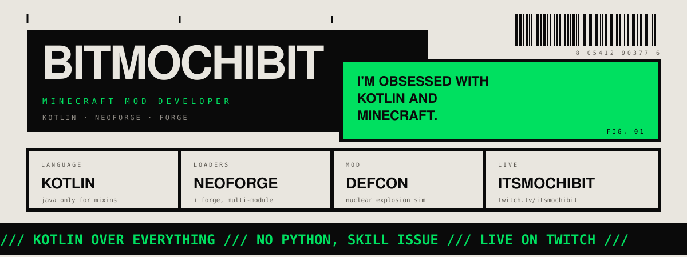

  

<h4 align="center">My current skills are (I removed python because it's skill-issue)</h4>

  
  
  
  
  
  
  
  
  

###

  
  
  
  
  
  
  
  
  

###

  
  
  

###

  
  
  

###

You can follow me on

  
  
  

